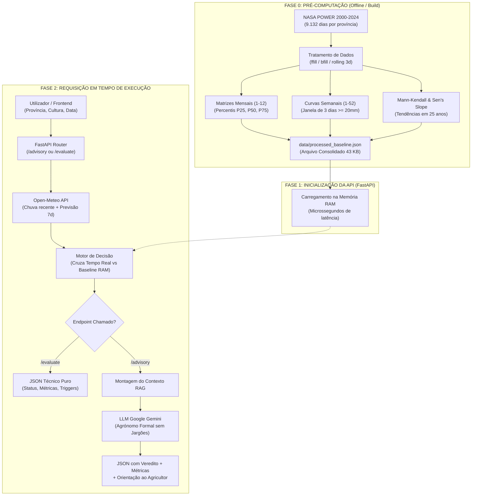
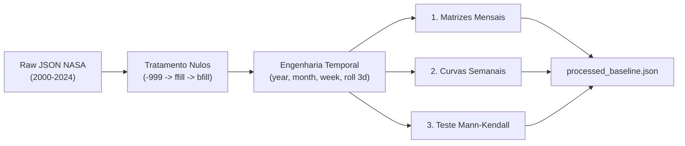
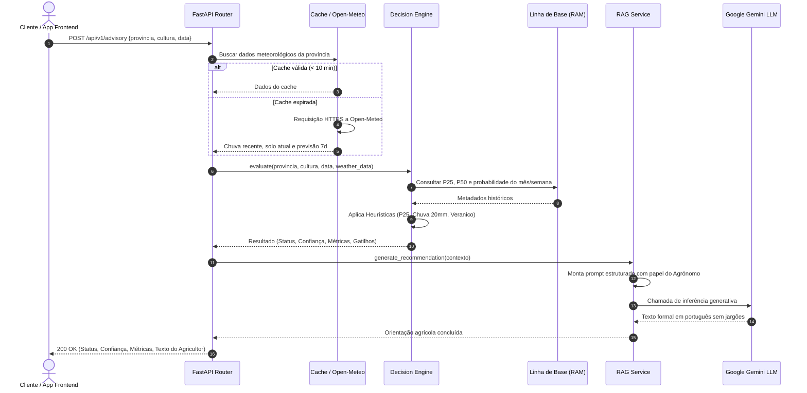

# 🏛️ Arquitetura Técnica e Fluxo Analítico End-to-End
### Sistema de Suporte à Decisão Agrícola — Planalto Central de Angola

Este documento foi elaborado para servir de guia completo e detalhado para **apresentações de equipa, reuniões técnicas e alinhamento de liderança**. Ele detalha como cada modelo estatístico opera, quais campos de dados são consumidos, o que acontece na pré-computação e o ciclo de vida exato de cada requisição.

---

## 📑 Índice
1. [Visão Geral Executiva](#1-visão-geral-executiva)
2. [As Fontes de Dados e Campos Utilizados](#2-as-fontes-de-dados-e-campos-utilizados)
3. [Fase 0: A Pré-Computação Estatística (Antes da Aplicação Subir)](#3-fase-0-a-pré-computação-estatística-antes-da-aplicação-subir)
4. [Fase 1: Inicialização do Servidor (Startup & Memória)](#4-fase-1-inicialização-do-servidor-startup--memória)
5. [Fase 2: O Ciclo de Vida da Requisição (No Meio de Cada Request/Response)](#5-fase-2-o-ciclo-de-vida-da-requisição-no-meio-de-cada-requestresponse)
6. [O Papel de Cada Modelo Estatístico e Agroclimático](#6-o-papel-de-cada-modelo-estatístico-e-agroclimático)
7. [Diferença Estrutural: `/evaluate` vs `/advisory`](#7-diferença-estrutural-evaluate-vs-advisory)
8. [Roteiro de 3 Minutos para Explicar em Reunião](#8-roteiro-de-3-minutos-para-explicar-em-reunião)

---

## 1. Visão Geral Executiva

O sistema tem como objetivo responder com precisão científica e foco económico a duas perguntas fundamentais para o agricultor e cooperativas do Planalto Central (Huambo, Bié, Huíla):
1. **Momento Operacional:** *"As condições atuais do solo e do tempo são seguras para lançar a semente à terra hoje?"*
2. **Planeamento Estratégico e Financeiro:** *"Vale a pena comprar sementes, arar o terreno e contratar mão-de-obra para semear em determinado mês (ex: Julho de 2027 vs Novembro de 2027), ou há risco de perder o investimento?"*

Para responder a isto, a arquitetura combina **quatro camadas integradas**:
1. **Memória Histórica (25 anos da NASA POWER - 2000 a 2024):** Define os padrões climáticos de 9.132 dias por província, percentis de água no solo e probabilidades de sementeira semana a semana (1 a 52).
2. **Perfis Biológicos Específicos por Cultura:** Regras dedicadas para **Milho** (5 cm, 20 mm), **Feijão** (sensível ao encharcamento com teto de humidade de 0.72) e **Soja** (alta demanda hídrica inicial com piso de humidade de 0.40).
3. **Motor Heurístico de Proteção de Recursos (Decision Engine):** Avalia deterministicamente o período consultado, acionando alertas de estiagem sazonal (Cacimbo), encharcamento ou viabilidade de safra.
4. **Camada de Tradução e Síntese Humana (RAG + Gemini):** Traduz dados científicos complexos numa orientação formal, simples, sem jargões e orientada à proteção do investimento do produtor.



---

## 2. As Fontes de Dados e Campos Utilizados

O sistema opera com duas fontes de dados estritamente complementares:

### A. Dados Históricos da NASA POWER (Comunidade AG - Agroclimatologia)
Série temporal contínua de **1 de Janeiro de 2000 a 31 de Dezembro de 2024** (9.132 medições diárias por província):

| Campo NASA | Significado Agroclimático | Unidade | Utilização no Sistema |
|---|---|---|---|
| `PRECTOTCORR` | Precipitação Total Diária Corrigida | mm/dia | Média mensal de chuvas e acumulado móvel de 3 dias. |
| `GWETROOT` | Humidade na Zona Radicular (0 a 1 metro) | Fração (0.0 a 1.0) | Percentil $P_{25}$ (limiar de seca), $P_{50}$ (mediana) e $P_{75}$. |
| `GWETTOP` | Humidade Superficial do Solo (0 a 5 cm) | Fração (0.0 a 1.0) | Avaliação da camada de contato imediato da semente. |
| `T2M` | Temperatura Média a 2 metros | °C | Média térmica histórica de referência. |
| `T2M_MAX` | Temperatura Máxima Diária | °C | Limiar térmico histórico para cálculo de stress calórico. |
| `T2M_MIN` | Temperatura Mínima Diária | °C | Controlo de amplitudes térmicas noturnas. |

### B. Dados em Tempo Real e Previsão da Open-Meteo
Capturados dinamicamente em cada chamada para as coordenadas exatas da província:

| Campo Open-Meteo | Período | Utilização no Sistema |
|---|---|---|
| `precipitation_sum` | Últimos 7 dias | Mede a chuva real caída recentemente (gatilho de abertura de covas). |
| `soil_moisture_0_to_7cm` | Momento Atual | Humidade superficial imediata onde a semente é colocada. |
| `soil_moisture_7_to_28cm` | Momento Atual | Humidade na profundidade da raiz das plantas jovens. |
| `precipitation_sum` | Próximos 7 dias | Volume previsto para sustentar a germinação inicial. |
| `temperature_2m_max` | Próximos 7 dias | Deteção de picos de calor ($> 32^\circ\text{C}$) causadores de morte da plântula. |

---

## 3. Fase 0: A Pré-Computação Estatística (Antes da Aplicação Subir)

Para garantir que a API responda em milissegundos sem sobrecarregar o servidor com cálculos matemáticos pesados de 25 anos de histórico em cada clique, existe uma **fase de pré-computação offline** gerada pelo [`src/baseline_engine.py`](file:///C:/Users/HP/Desktop/Nasa Space Apps/src/baseline_engine.py):



### 1. Ingestão e Limpeza de Dados:
- Os valores ausentes da NASA (marcados como `-999.0` ou `null`) são substituídos por `NaN`.
- Aplica-se **imputação bidirecional**: `ffill()` (propaga o último valor válido para a frente) seguido de `bfill()` (preenche retroativamente qualquer início vazio). Isso preserva a continuidade da série temporal sem distorcer médias.

### 2. Matriz Agroclimática Mensal (Meses 1 a 12):
Para cada mês do ano, em cada província:
* **Precipitação Média Mensal:** Soma mensal agrupada por ano e calculada a média dos 25 anos.
* **Probabilidade de Dia Chuvoso:** $\frac{\text{Dias com } PRECTOTCORR \ge 5.0\text{ mm}}{\text{Total de Dias do Mês}} \times 100$.
* **Percentis de Humidade da Raiz ($GWETROOT$):**
  * **$P_{25}$ (Percentil 25 - Limiar Crítico de Estresse):** 75% dos dias históricos tiveram mais água que este valor. Se o solo atual estiver abaixo de $P_{25}$, a planta enfrentará estresse hídrico severo.
  * **$P_{50}$ (Mediana):** O padrão típico de água no solo para aquele mês.
  * **$P_{75}$ (Percentil 75):** Nível de solo com excelentes reservas hídricas.

### 3. Curva de Sementeira Semanal (Semanas 1 a 52):
* Calcula a **janela deslizante de 3 dias de chuva acumulada**:
  $$\text{Chuva\_Acumulada\_3D}_t = \sum_{i=0}^{2} PRECTOTCORR_{t-i}$$
* **Probabilidade de Condição de Sementeira:** Percentagem de anos em que a referida semana do ano registou pelo menos um evento com $\text{Chuva\_Acumulada\_3D} \ge 20.0\text{ mm}$ (volume agronómico mínimo para molhar a camada de plantio do milho/feijão).

### 4. Teste de Tendências Climáticas de Mann-Kendall:
* O sistema agrega anualmente a precipitação, temperatura e humidade (25 pontos temporais).
* Executa o teste estatístico não-paramétrico de Mann-Kendall (`pymannkendall.original_test`):
  * **Estatística $S$ e $Z$-Score:** Avalia se os valores crescem ou decrescem monotonicamente ao longo dos anos.
  * **$p$-valor:** Se $p < 0.05$, a tendência é estatisticamente significante.
  * **Declive de Sen (Sen's Slope):** Mede a taxa real de variação por ano (ex: mm de chuva ganhos ou perdidos por ano).
* **Conclusão para Huambo, Bié e Huíla:** O teste indicou `"no trend"` estatisticamente preponderante no volume anual de chuva, comprovando que o regime de chuvas histórico do Planalto Central ainda preserva a sua sazonalidade de referência.

### 5. Saída Consolidada:
Toda esta computação é consolidada e gravada em [`data/processed_baseline.json`](file:///C:/Users/HP/Desktop/Nasa Space Apps/data/processed_baseline.json) (43.4 KB).

---

## 4. Fase 1: Inicialização do Servidor (Startup & Memória)

Quando o serviço inicia no Render/servidor local ([`main.py`](file:///C:/Users/HP/Desktop/Nasa Space Apps/main.py)):

1. **Lifespan Event:** O FastAPI lê o ficheiro `processed_baseline.json` uma única vez no arranque e armazena os dicionários em memória RAM.
2. **Desempenho:** Qualquer consulta subsequente acede aos percentis e médias históricas em **microssegundos ($< 1\text{ ms}$)**, sem tocar em disco e sem reprocessar gigabytes de dados brutos.
3. **Segurança:** O sistema verifica se a variável `ENVIRONMENT=production`. Em caso afirmativo, desliga completamente o Swagger UI (`/docs`), ReDoc (`/redoc`) e `/openapi.json` para proteger a API contra inspeção pública.

---

## 5. Fase 2: O Ciclo de Vida da Requisição (No Meio de Cada Request/Response)

Quando uma aplicação ou utilizador chama `POST /api/v1/advisory`, o seguinte ciclo ocorre em menos de 1,5 segundos:



### Detalhe Passo a Passo:

#### Passo 1: Recebimento e Validação da Requisição
- O FastAPI valida o JSON via Pydantic (`AdvisoryRequest`).
- Se a província for omitida ou inválida, retorna `422/400`. Se `cultura` não for informada, assume `"Milho"`. Se `data_consulta` não for enviada, assume o dia atual.

#### Passo 2: Coleta Meteorológica em Tempo Real (`weather_service.py`)
- O serviço consulta a Open-Meteo para a latitude/longitude da província.
- **Cache Inteligente:** Se a mesma província for consultada num intervalo de até 10 minutos, o sistema responde a partir da memória, poupando chamadas externas e acelerando a resposta.
- **Fallback Resiliente:** Se a Open-Meteo estiver indisponível ou sofrer timeout, o sistema ativa a média histórica da NASA para aquele dia, garantindo que o agricultor nunca fica sem resposta.

#### Passo 3: Avaliação das Regras Agroclimáticas (`decision_engine.py`)
O motor cruza os dados do tempo real com a linha de base em RAM:
1. **Gatilho de Humidade Crítica na Raiz (`CRITICAL_ROOT_MOISTURE`):**
   Compara a humidade atual na raiz (7-28 cm) com o limiar histórico $P_{25}$ do mês. Se $\text{Humidade Atual} < P_{25}$, aciona alerta de solo seco.
2. **Gatilho de Chuva Recente / Iminente (`RECENT_RAIN_TRIGGER`):**
   Verifica se nos últimos 3 a 5 dias choveu $\ge 20.0\text{ mm}$ OU se as próximas 48 horas têm previsão confirmada de chuva $\ge 25.0\text{ mm}$.
3. **Gatilho de Falsa Partida / Veranico (`DRY_SPELL_HEAT_RISK`):**
   Alerta crítico: se choveu recentemente, mas a previsão dos próximos 7 dias prevê $\le 2.0\text{ mm}$ com calor intenso ($T_{\max} \ge 32^\circ\text{C}$). Isto previne que o agricultor semeie numa "falsa chuva" e veja a sua sementeira queimar por calor antes de enraizar.
4. **Veredito Determinístico:**
   - **`FAVORAVEL`:** Raiz com humidade $\ge P_{25}$ + Chuva recente/iminente ativa + Sem risco de veranico.
   - **`AGUARDAR`:** Solo ainda em recarga hídrica lenta, ou chuva iminente prevista em 48h onde se recomenda esperar 2 a 3 dias para a terra absorver a água, ou risco de veranico detectado.
   - **`DESFAVORAVEL`:** Solo criticamente seco sem chuvas à vista ou estiagem severa.
5. **Cálculo do Score de Confiança (0 a 100%):**
   Pondera a convergência entre os dados atuais observados, a consistência da previsão e a probabilidade histórica do mês na base de 25 anos da NASA.

#### Passo 4: Síntese pelo Pipeline RAG (`rag_service.py`)
O `decision_engine` calculou os números, mas agricultores não leem percentis. É aqui que entra o **RAG**:
1. O backend monta um **bloco de contexto dinâmico** com:
   - Cultura escolhida e profundidade ideal (ex: 5 cm para milho).
   - Humidade atual vs percentil histórico.
   - Histórico do mês e estabilidade climática.
   - Previsão do tempo e veredito do motor de regras.
2. Envia este bloco ao **Google Gemini 3.5 Flash** com diretrizes estritas:
   - **Papel:** Engenheiro Agrónomo local experiente no Planalto Central de Angola.
   - **Tom:** Formal, respeitoso, claro, didático e prático.
   - **Filtro de Segurança Verbal:** Proibição de termos como *"Mann-Kendall"*, *"SARIMA"*, *"p-valor"*, *"P25"*, *"GWETROOT"* ou *"APIs"*.
   - **Entrega Obrigatória:**
     1. Veredito claro (**FAVORÁVEL**, **AGUARDAR** ou **NÃO PLANTAR**).
     2. 2 a 3 justificações objetivas do terreno.
     3. Dica prática de campo (o tradicional **teste do torrão de terra na palma da mão a 5 cm de profundidade**).

#### Passo 5: Montagem da Resposta Final
A API empacota os dados e entrega ao utilizador:
```json
{
  "status": "AGUARDAR",
  "score_confianca": 82,
  "metricas": {
    "chuva_acumulada_recente_mm": 48.2,
    "humidade_solo_raiz": 0.34,
    "previsao_7dias_mm": 83.4
  },
  "recomendacao_extensao": "**AGUARDAR: Recomenda-se aguardar antes de realizar a sementeira...**"
}
```

---

## 6. O Papel de Cada Modelo Estatístico e Agroclimático

Para explicar numa reunião como a matemática apoia o negócio:

| Modelo / Algoritmo | Onde Atua | O que Faz | Como Contribui para a Decisão |
|---|---|---|---|
| **Janela Móvel Deslizante (Rolling 3-Day)** | Pré-computação | Soma acumulada móvel de 3 dias de chuva em 25 anos. | Define o padrão empírico de chuva suficiente para quebrar a dessecação do solo. |
| **Percentis Não-Paramétricos ($P_{25}, P_{50}, P_{75}$)** | Pré-computação | Divide o histórico diário de água na raiz por patamares de distribuição. | O $P_{25}$ funciona como o limite inferior de sobrevivência hídrica da semente. |
| **Teste de Mann-Kendall & Sen's Slope** | Pré-computação | Avalia monotonicidade e declive das chuvas e temperaturas de 2000 a 2024. | Valida se a climatologia histórica ainda é confiável hoje (confirma que o regime sazonal é estável). |
| **Motor Heurístico de Limiares** | Em cada requisição | Cruza métricas de tempo real contra os limiares pré-computados. | Toma a decisão fria, determinística e auditável (`FAVORAVEL`, `AGUARDAR`, `DESFAVORAVEL`). |
| **Pipeline RAG + LLM (Gemini)** | Em cada requisição | Converte o veredito num parecer formal agronómico contextualizado. | Transforma dados matemáticos abstratos em conhecimento prático acionável para o produtor rural. |

---

## 7. Diferença Estrutural: `/evaluate` vs `/advisory`

| Característica | `POST /api/v1/evaluate` | `POST /api/v1/advisory` |
|---|---|---|
| **Objetivo** | Diagnóstico rápido e técnico dos dados. | Recomendação agronómica completa ao agricultor. |
| **Usa Histórico da NASA?** | Sim (percentis e limiares). | Sim (percentis e limiares). |
| **Usa Tempo Real (Open-Meteo)?** | Sim. | Sim. |
| **Usa Motor de Regras?** | Sim. | Sim. |
| **Chama Inteligência Artificial (Gemini)?** | **Não** (100% determinístico). | **Sim** (Pipeline RAG). |
| **Tempo Médio de Resposta** | $\approx 100\text{ a } 200\text{ ms}$ | $\approx 1000\text{ a } 1500\text{ ms}$ |
| **Consumo Recomendado** | Dashboards internos, testes ou gráficos. | **Ecrã principal da aplicação / WhatsApp do produtor.** |

---

## 8. Roteiro de 3 Minutos para Explicar em Reunião

Se tiver de apresentar este sistema à equipa ou diretoria em poucos minutos, utilize este roteiro:

1. **O Desafio do Agricultor:**  
   *"No Planalto Central, plantar cedo demais numa chuva falsa significa perder a semente por falta de água na raiz. Plantar tarde demais significa perder a janela produtiva da época chuvosa."*

2. **A Solução Científica (O que fizemos antes):**  
   *"Não dependemos de palpites. Processámos 25 anos de observações diárias de satélite da NASA (2000 a 2024). Criámos uma linha de base matemática com percentis de água no solo e testámos a estabilidade climática com o modelo estatístico de Mann-Kendall. Esse conhecimento fica guardado na memória da API."*

3. **A Operação em Tempo Real (O que acontece no clique do utilizador):**  
   *"Quando o agricultor escolhe a sua província (Huambo, Bié ou Huíla) e cultura (Milho, Feijão ou Soja), o sistema busca a meteorologia ao vivo e cruza o solo atual com a nossa régua de 25 anos. O motor calcula se o solo tem reserva de raiz ($> P_{25}$) e se há risco de estiagem nos próximos 7 dias."*

4. **A Entrega em Linguagem Humana (O RAG):**  
   *"Por fim, para não atirar percentuais e jargões ao homem do campo, o nosso pipeline RAG com o Google Gemini assume o papel de um Engenheiro Agrónomo formal. Ele entrega uma mensagem clara com o veredito, os motivos e o teste prático de campo do torrão de terra."*
